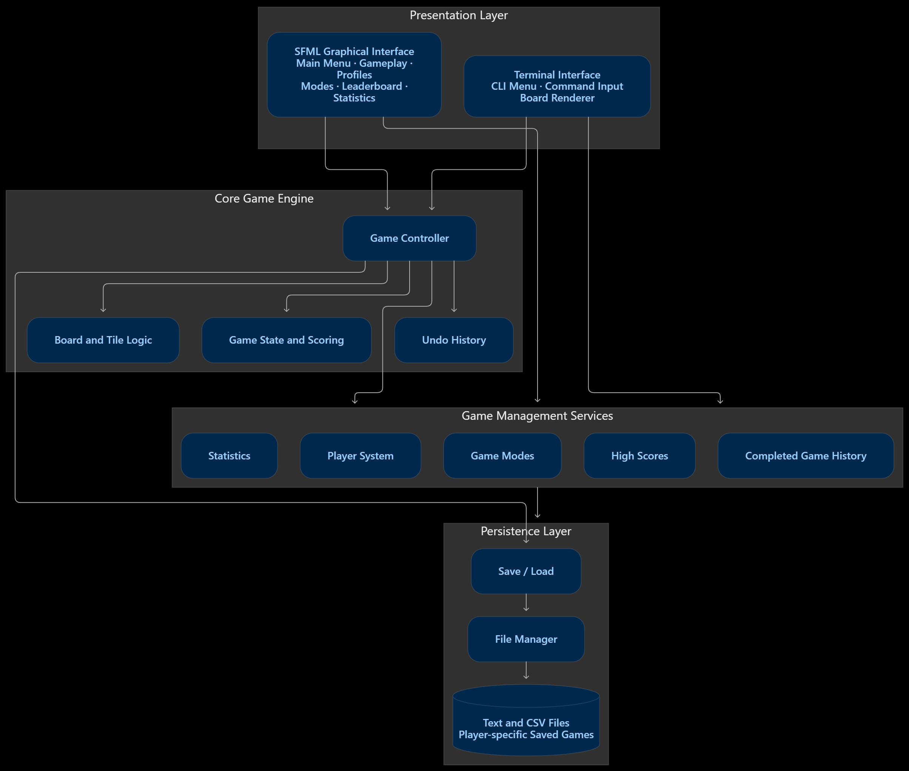
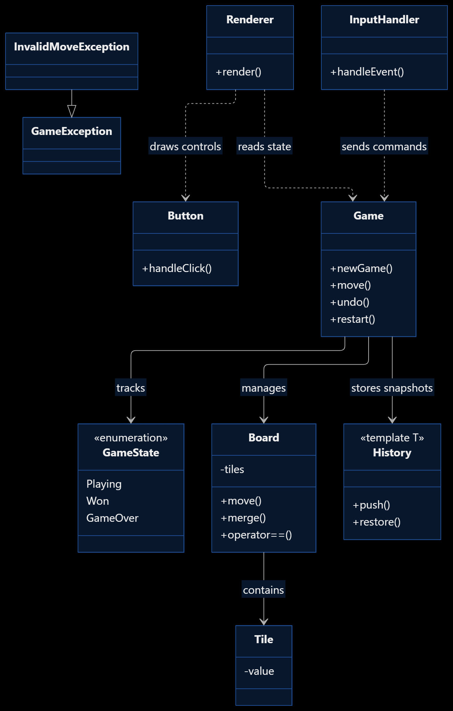

# 2048 Game Engine — C++ & SFML

A modular, object-oriented implementation of 2048 with an SFML desktop interface and extended gameplay features. This completed application was developed by **Lathikaa and Reenasa** as an Object-Oriented Programming course project.

## Contents

- [Overview](#overview)
- [Features](#features)
- [Game modes](#game-modes)
- [Themes](#themes)
- [Technologies](#technologies)
- [Architecture](#architecture)
- [OOP concepts](#object-oriented-programming-concepts)
- [Project structure](#project-structure)
- [Setup and build](#installation-and-setup)
- [Controls](#controls)
- [Save and load](#save-and-load)
- [Testing](#testing)
- [Contributors](#contributors)
- [Project status](#project-status)
- [License](#license)

## Overview

Combine equal numbered tiles by sliding them across the board. Each successful move merges matching tiles once per move, adds the merged value to the score, and spawns a new tile (a 2 in 90% of spawns, otherwise a 4). Standard play aims for 2048. The game detects a win when the configured target is reached and a loss when no moves remain. The default board is 4×4; 3×3 and 5×5 are also available.

## Features

- 3×3, 4×4, and 5×5 boards
- Up, down, left, and right movement, with standard one-merge-per-tile rules
- Random tile generation and score tracking
- Undo of successful moves, including board, score, and game state
- New game and restart handling
- Standard, Endless, and user-configured Target modes
- Optional obstacle boards: obstacle cells display `X`, block tile movement and merging, and are enabled or disabled from the main menu for new games. New games start with **1 obstacle on 3×3**, **2 on 4×4**, and **3 on 5×5** boards.
- Five selectable visual themes
- In-session player profiles, leaderboard, and statistics
- Player-specific save and load
- SFML graphical menus, board rendering, and mouse buttons
- Input validation, exception handling, and CTest regression suites

Target Mode accepts a whole-number power of two from **2 through 1,048,576**, inclusive. Empty input, non-numeric input, values outside this range, and values that are not powers of two are rejected; the mode selection is not changed on invalid input.

Profiles accept unique names of 1–20 ASCII letters, digits, underscores, or hyphens. `Guest` is reserved. Profiles, statistics, and leaderboard records are held for the current application session; the saved game file is player-specific.

## Game modes

Choose **Game Modes** from the main menu. The selection applies to newly started games. For Target Mode, select it to open the target entry screen, enter a value, and confirm with Enter or the Confirm button.

| Mode | Goal | End condition |
|---|---|---|
| Standard | Reach 2048 | Win on reaching 2048, or lose when no moves remain |
| Endless | Continue without a fixed winning target | Lose when no moves remain |
| Target | Reach the valid tile value entered by the player | Win on reaching the selected target, or lose when no moves remain |

## Themes

Select **Themes** from the main menu. The available themes are **Classic**, **Dark**, **Matcha**, **RoseGold**, and **StarryNight**. Neon is not available.

## Technologies

| Technology | Role |
|---|---|
| C++17 | Game engine, application, and user interface implementation |
| SFML 2.6.2 | Desktop window, graphics, events, and input |
| CMake | Configures engine, GUI, and test targets |
| CTest | Registers and runs regression tests |
| MinGW GCC | Windows C++ compiler used for the project build |
| C++ STL | Containers, algorithms, random number generation, streams, and file utilities |
| Git and GitHub | Version control and collaborative project hosting |

## Architecture

The code separates the SFML presentation layer (`src/ui/`) from the game and session logic (`src/core/`). The `engine2048` CMake library builds without the GUI; the `ui2048` library connects the engine to SFML, and `main.cpp` starts the desktop application.

### Core and UI responsibilities

| Class | Responsibility |
|---|---|
| `Game` | Owns the active board, score manager, mode, state, and undo snapshots; applies moves and updates win/loss state. |
| `Board` | Stores the dynamic square grid; moves and merges tiles, spawns tiles/obstacles, and detects available moves. |
| `Tile` | Represents a cell and its value; `ObstacleTile` specializes obstacle behavior. |
| `Session` | Coordinates player selection, game setup, statistics, scores, and save/load. |
| `GameModes` | Stores Standard, Endless, or Target rules and checks the winning target. |
| `ScoreManager` | Tracks the current score. |
| `PlayerSystem` | Creates, lists, and selects in-session player profiles. |
| `HighScoreSystem` | Maintains a top-ten leaderboard in memory, with the best score per player. |
| `Statistics` | Tracks games started, successful moves, and the best tile during this application session. |
| `SaveGame` and `LoadGame` | Write and read a player's text save through `FileManager`. |
| `Renderer` | Draws the board, tiles, score, game state, and restart control with SFML. |
| `InputHandler` | Maps gameplay key events to engine moves, undo, restart, and close requests. |
| `Application` | Owns the SFML event loop and connects menus, session actions, input, and rendering. |

`History<T>` is the generic stack used for undo. `GameHistory` and `PersistentData` are also present as separate utility components; they are not currently wired into the graphical session's history/statistics flow.

### Input and rendering flow

SFML events enter `Application`. Menu and mouse events are handled by the application; gameplay key events are passed to `InputHandler`, which calls `Game`. The engine updates its board, score, state, and undo history. `Application` records successful activity in `Session`, and `Renderer` draws the resulting game state on the next frame.

### Architecture diagrams

The repository diagrams are retained for reference, but **both are outdated and do not fully represent the current application**. `Architecture.png` depicts a terminal interface alongside the GUI, while the current built application is SFML-based; `UML.png` omits current classes and has stale state/class details. Use the source code and the descriptions above as the current architecture reference.





## Object-Oriented Programming concepts

- **Classes and objects:** `Game`, `Board`, `Tile`, `Session`, and the UI classes model distinct game responsibilities.
- **Encapsulation:** `Board` keeps its grid private and exposes tile access, movement, and state queries through methods. `Game` similarly exposes read-only board access and controlled game operations.
- **Abstraction:** Callers request `Game::move(Direction)` without implementing line compression, merging, spawning, scoring, or state checks themselves.
- **Inheritance and polymorphism:** `ObstacleTile` derives from `Tile`; `Tile` provides virtual behavior such as `isMovable`, `isEmpty`, and merge operations, with obstacle behavior specialized in the derived class.
- **Constructors:** `Board` supports a validated size; `Game` constructors initialize a default game, a board snapshot, or a sized game with a mode and obstacles.
- **Templates:** `History<T>` provides a reusable typed history stack. `TemplateComponent<T>` in `templateComponent.h` is another generic grid utility.
- **Operator overloading:** `Board` overloads `==` and `!=` for board comparison and `<<` for stream output.
- **Exception handling:** Invalid directions raise `InvalidMoveException`; invalid sizes, mode targets, and other errors use standard or project exceptions. The application catches errors and displays the message; `main` catches startup exceptions.
- **Composition:** `Game` owns a `Board`, `ScoreManager`, `GameModes`, and `History<GameSnapshot>`. `Application` coordinates the renderer, input handler, session, theme manager, and menus.

## Project structure

```text
2048-Game-Engine/
├── assets/
│   ├── fonts/
│   │   ├── 2048.ttf
│   │   └── README.md
│   ├── icons/
│   └── textures/
├── docs/
│   ├── problem-statement/
│   ├── report/
│   └── uml/
├── include/
│   ├── core/
│   ├── exceptions/
│   ├── ui/
│   └── utils/
├── src/
│   ├── core/
│   └── ui/
├── tests/
│   ├── ApplicationRegression.cpp
│   ├── InputRegression.cpp
│   ├── IntegrationRegression.cpp
│   └── Regression.cpp
├── Architecture.png
├── CMakeLists.txt
├── LICENSE
├── main.cpp
├── README.md
└── UML.png
```

## Installation and setup

### Prerequisites

- Windows with a C++17-compatible MinGW GCC toolchain
- CMake
- SFML 2.6.2 built for the selected compiler and architecture
- Git

Clone the repository:

```powershell
git clone https://github.com/lathikaa-j/2048-Game-Engine.git
cd 2048-Game-Engine
```

Configure and build the GUI application:

```powershell
cmake -S . -B build
cmake --build build
```

If CMake cannot locate SFML, set `SFML_DIR` to the directory containing `SFMLConfig.cmake` for your SFML installation. For example:

```powershell
cmake -S . -B build -DSFML_DIR="C:/Libraries/SFML-2.6.2/lib/cmake/SFML"
cmake --build build
```

Adjust the example path to your installation. SFML must match the MinGW compiler and 32-bit or 64-bit target used for the build.

Run from the repository root:

```powershell
.\build\game2048.exe
```

CMake copies `assets/` beside the executable after building. SFML's required runtime DLLs must also be discoverable by Windows, usually by placing the matching SFML DLLs beside `game2048.exe` or adding their `bin` directory to `PATH`. The default font is `assets/fonts/2048.ttf`; a font path can be supplied as the first command-line argument. The included font asset is expected to be present in the repository.

To build only the non-GUI engine and its tests, configure with `-DGAME2048_BUILD_GUI=OFF`; this avoids the SFML requirement.

## Controls

| Input | Action |
|---|---|
| Arrow keys or `W`, `A`, `S`, `D` | Move tiles up, left, down, or right |
| `U` | Undo the last successful move |
| `R` | Restart the current game |
| `Esc` | Return to the main menu; exit when on the main menu. In Target entry, return to Game Modes. |
| Left mouse click | Select menu actions and gameplay buttons |
| `Enter` | Confirm Target Mode value or create/select a profile while entering a name |
| Backspace | Edit profile name or Target Mode value |

On the gameplay screen, **Menu** returns to the main menu and **Save** writes the current game. A restart button is available in the header and after a win or game over.

## Save and load

During a game, click **Save**. From the main menu, choose **Load Game** and select **Load selected player's save**. Saves are player-specific text files named `<player>_save.txt`—for example, `Guest_save.txt`—in the application's **current working directory**. Run from the project root to keep saves there. The format stores the score, board values (including obstacle cells), game mode and Target Mode goal, and board size. Older grid saves without metadata are accepted as Standard mode when their dimensions are supported.

Loading validates the complete save before replacing the active game; invalid data preserves current progress. Undo history is cleared on load. The game state is recalculated from the loaded board and mode. Profiles, leaderboard, and statistics are session-only and are not included in the save file.

## Testing

The project registers regression tests with CTest. After configuring and building, run:

```powershell
ctest --test-dir build --output-on-failure
```

`Regression.cpp` covers board movement and merging, scoring, state transitions, undo/history, and exception behavior. `InputRegression.cpp` checks keyboard mappings, ignored input, and restart/undo handling. `IntegrationRegression.cpp` covers profiles, session behavior, statistics and leaderboard, persistence and legacy saves, Target Mode, board sizes, obstacles, and invalid save handling. `ApplicationRegression.cpp` exercises menu navigation, profile and target entry, themes, board sizes, obstacle selection, and application input/rendering integration.

The GUI and its application regression target require SFML. To build and run only backend and integration tests without SFML:

```powershell
cmake -S . -B build-backend -DGAME2048_BUILD_GUI=OFF
cmake --build build-backend
ctest --test-dir build-backend --output-on-failure
```

## Contributors

- **Lathikaa**
- **Reenasa**

## Project status

The integrated graphical application and game engine are implemented, built, and regression-tested. The project includes backend, integration, input, and application regression suites. Run the build and CTest commands above with the required local compiler and SFML installation to repeat verification in your environment.

## License

This project is licensed under the **MIT License**. See [LICENSE](LICENSE) for the complete terms.
